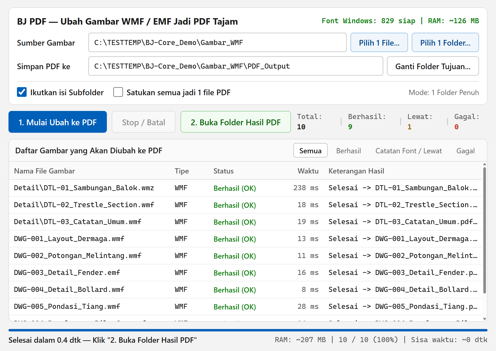
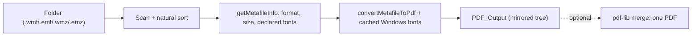

<div align="center">


# BJ-Core

**Batch-convert WMF / EMF drawings to true vector PDF on Windows**  
*Pick a folder → get one crisp PDF per drawing. Lines, hatches, clipping and text stay vector, 1:1 with the original metafile.*

[](https://github.com/Asikraam/BJ-Core/releases)
[](https://github.com/Asikraam/BJ-Core/releases)
[](https://github.com/Asikraam/BJ-Core/actions)
[](LICENSE)

**English** · [Panduan Bahasa Indonesia](docs/README_ID.md) · [Pituduh Basa Sunda](docs/README_SU.md) · [Changelog](CHANGELOG.md)

[Download](#-download--install) · [Features](#-whats-inside) · [How It Works](#%EF%B8%8F-under-the-hood) · [Run from Source](#%EF%B8%8F-run-from-source)

<br />



</div>

---

## ✨ Why BJ-Core?

- **Vector in, vector out:** Every `.wmf`, `.emf`, `.wmz` and `.emz` is replayed into PDF paths, not screenshots. Zoom to 6400% in any PDF viewer and the lines stay sharp.
- **Your fonts, embedded:** All installed Windows fonts are cached once at startup and embedded as TrueType subsets, so title blocks and dimensions don't shift. Missing faces are flagged before conversion.
- **Whole folders at once:** Drop a folder, tick **Process Subfolders**, press **Convert**. The output tree mirrors the source tree in `PDF_Output`, with an optional single merged PDF.
- **Built for drafters:** A plain Windows 11–style utility window. A file queue with status, duration and notes per drawing, filter tabs, an ETA, and a **Cancel** button that stops mid-batch.

---

## 📦 Download & Install

Grab a package from [**GitHub Releases**](https://github.com/Asikraam/BJ-Core/releases/latest):

| Platform | File | Who It Is For |
| :--- | :--- | :--- |
| **Windows 10 / 11 (x64)** | [`BJ-Core-Setup-v1.0.0-win-x64.exe`](https://github.com/Asikraam/BJ-Core/releases/latest) | **Recommended**: 1-click installer (Desktop & Start Menu shortcuts) |
| **Windows 10 / 11 (x64)** | [`BJ-Core-v1.0.0-win-x64-Portable.zip`](https://github.com/Asikraam/BJ-Core/releases/latest) | **Portable**: extract anywhere and run `BJ-Core.exe`, nothing to install |

**1-command PowerShell install (no Git or Node.js needed):**
```powershell
$r = Invoke-RestMethod "https://api.github.com/repos/Asikraam/BJ-Core/releases/latest"; $u = ($r.assets | Where-Object { $_.name -like "*Setup*.exe" } | Select-Object -First 1).browser_download_url; $f = "$env:TEMP\BJ-Core-Setup.exe"; Invoke-WebRequest $u -OutFile $f; Start-Process $f
```

> **"Windows protected your PC"?** Indie open-source apps without a paid code-signing certificate trigger SmartScreen at first. Click **More info** → **Run anyway**, or verify the SHA-256 checksums published on the [release page](https://github.com/Asikraam/BJ-Core/releases/latest).

---

## 🧩 What's Inside

| Area | Details |
| :--- | :--- |
| **Input formats** | `.wmf` (incl. Aldus placeable), `.emf`, `.emf+` / dual, gzip `.wmz` / `.emz` |
| **Output** | One vector PDF per drawing, page size = drawing bounds (1 px = 0.75 pt), Flate-compressed |
| **Quality settings** | `pageSize: 'drawing'`, `gdiAntialias: true`, `exactRasterOps: true` (ROP2/ROP3 hatches), `imageResampling: 'renderer'` (embedded bitmaps kept at source resolution) |
| **Fonts** | Windows fonts loaded once (`loadSystemFonts()`), reused across the batch; `[FONT]` warning per file when a declared face is missing |
| **Batch** | Recursive scan, natural sort (`DWG-2` before `DWG-10`), mirrored folder structure, optional merge into one PDF via `pdf-lib` |
| **UI** | Drag-and-drop folder, auto output path, live queue table with filters, progress bar + ETA, cancel, open output folder |

---

## ⚙️ Under the Hood



- **Electron 44 + TypeScript + Vite.** The conversion runs in the main process; the renderer only talks to it through a typed `contextBridge` API (`contextIsolation: true`, `nodeIntegration: false`).
- **[`emf-converter`](https://github.com/ChristopherVR/emf-converter)** replays every GDI / EMF+ record onto an SVG tree, then serialises it as PDF 1.7: real paths, clip chains, shading patterns and embedded TrueType subsets.
- **[`pdf-lib`](https://pdf-lib.js.org/)** handles the optional merge.
- **Trade-off:** quality comes first. Each drawing is fully replayed with exact raster ops and embedded fonts, so very heavy metafiles take longer than a quick bitmap export.

---

## 🛠️ Run from Source

```powershell
git clone https://github.com/Asikraam/BJ-Core.git
cd BJ-Core
npm install
npm start           # build + launch
```

| Command | Purpose |
| :--- | :--- |
| `npm run typecheck` | Type-check main + renderer |
| `npm test` | Batch conversion test (WMF, WMZ in subfolder, corrupt file, missing font, merge) |
| `npm run build` | Build `BJ-Core-Setup-*.exe` + `*-Portable.zip` into `release/` |
| `npm run capture` | Re-render `assets/screenshot.png` and the app icon |

---

## 📄 License

[Apache-2.0](LICENSE) © 2026 Aswal Ikraam Aritonang. Conversion engine: [`emf-converter`](https://github.com/ChristopherVR/emf-converter) (Apache-2.0). Merge: [`pdf-lib`](https://github.com/Hopding/pdf-lib) (MIT).
