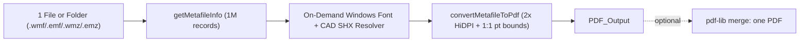

<div align="center">


# BJ PDF (`BJ-Core`)

**Single-file & batch WMF / EMF to true vector PDF converter for Windows**  
*Pick a single drawing or a whole folder → get crisp 1:1 vector PDFs with 2x HiDPI precision, embedded Windows fonts, and ~130 MB RAM usage.*

[](https://github.com/Asikraam/BJ-Core/releases)
[](https://github.com/Asikraam/BJ-Core/releases)
[](https://github.com/Asikraam/BJ-Core/actions)
[](LICENSE)
[-0ea5e9?style=for-the-badge)](#-whats-new-in-v110)

**English** · [Panduan Bahasa Indonesia](docs/README_ID.md) · [Pituduh Basa Sunda (Sapopoe)](docs/README_SU.md) · [Changelog](CHANGELOG.md)

[Download](#-download--install) · [What's New in v1.1.0](#-whats-new-in-v110) · [How It Works](#%EF%B8%8F-under-the-hood) · [Run from Source](#%EF%B8%8F-run-from-source)

<br />


</div>

---

## 🚀 What's New in `v1.1.0`

- **Single-File, Multi-File, or Full Folder Mode:** Click **`Pilih 1 File...`** to convert just one (or a few) `.wmf`/`.emf` drawings, or **`Pilih 1 Folder...`** to convert an entire directory tree. Drag-and-drop works for both single files and folders.
- **Drafter-Friendly Numbered Workflow:** Clear, plain-language buttons designed for senior & everyday CAD drafters: **`1. Mulai Ubah ke PDF`** → **`2. Buka Folder Hasil PDF`**.
- **5× Lower RAM (~110–160 MB / ~0.13 GB vs 0.76 GB in v1.0.0):** Lightweight SFNT `name`-table header indexing scans all 800+ Windows fonts in ~5 MB RAM and loads full font binaries on demand only for faces actually referenced by your drawings, with a live `RAM: ~... MB` readout in the status bar.
- **Enhanced 2× HiDPI Vector & CAD SHX Font Quality:** Renders internal GDI/hatch placement at `dpiScale: 2` while preserving 1:1 physical PDF page bounds (`maxCanvasDimension: 16384`, `maxRecords: 1,000,000`), plus smart AutoCAD `.shx` font fallback (`simplex`, `romans`, `isocp`, `txt` → `ISOCPEUR` / `Consolas` / `Arial`).
- **Native `BJ PDF` App & Taskbar Icon:** Bundled `.ico` resource applied to the Windows taskbar, titlebar, desktop shortcut, and installer.

---

## 📦 Download & Install

Grab the latest **`v1.1.0`** package from [**GitHub Releases**](https://github.com/Asikraam/BJ-Core/releases/latest) *(or roll back anytime to [`v1.0.0`](https://github.com/Asikraam/BJ-Core/releases/tag/v1.0.0))*:

| Platform | File | Who It Is For |
| :--- | :--- | :--- |
| **Windows 10 / 11 (x64)** | [`BJ-PDF-Setup-v1.1.0-win-x64.exe`](https://github.com/Asikraam/BJ-Core/releases/latest) | **Recommended**: 1-click installer (Desktop & Start Menu shortcuts) |
| **Windows 10 / 11 (x64)** | [`BJ-PDF-v1.1.0-win-x64-Portable.zip`](https://github.com/Asikraam/BJ-Core/releases/latest) | **Portable**: extract anywhere and run `BJ PDF.exe`, nothing to install |
| **Previous Release (`v1.0.0`)** | [`Release v1.0.0`](https://github.com/Asikraam/BJ-Core/releases/tag/v1.0.0) | Previous version for rollback if needed |

**1-command PowerShell install (no Git or Node.js needed):**
```powershell
$r = Invoke-RestMethod "https://api.github.com/repos/Asikraam/BJ-Core/releases/latest"; $u = ($r.assets | Where-Object { $_.name -like "*Setup*.exe" } | Select-Object -First 1).browser_download_url; $f = "$env:TEMP\BJ-PDF-Setup.exe"; Invoke-WebRequest $u -OutFile $f; Start-Process $f
```

---

## ⚙️ Under the Hood



---

## 🛠️ Run from Source

```powershell
git clone https://github.com/Asikraam/BJ-Core.git
cd BJ-Core
npm install
npm start
```

| Command | Purpose |
| :--- | :--- |
| `npm run typecheck` | Type-check main + renderer |
| `npm test` | Batch & single-file conversion test |
| `npm run build` | Build `BJ-PDF-Setup-v1.1.0-win-x64.exe` + `*-Portable.zip` into `release/` |

---

## 📄 License

[Apache-2.0](LICENSE) © 2026 Aswal Ikraam Aritonang.
