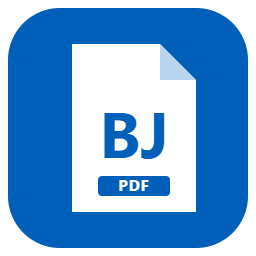
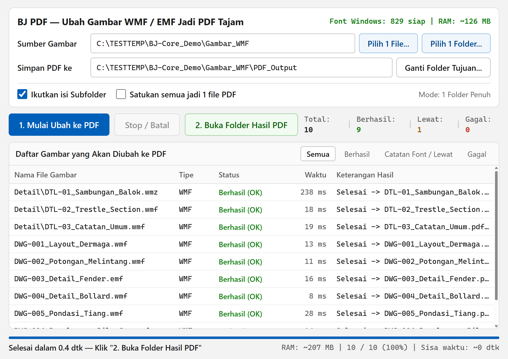

# BJ PDF — Panduan Pemakaian (Bahasa Indonesia)

**Alat Pengubah Gambar WMF / EMF ke PDF Vektor Tajam di Windows**  
*Bisa pilih 1 file gambar saja, atau langsung 1 folder penuh. Tombol dibuat sangat jelas dan mudah dipakai.*

[English (Default)](../README.md) · **Bahasa Indonesia** · [Basa Sunda](README_SU.md) · [Changelog](../CHANGELOG.md)

 

---

## 1. Cara Pasang di Laptop

Buka halaman [**GitHub Releases**](https://github.com/Asikraam/BJ-Core/releases/latest), lalu pilih salah satu:

### Opsi A — Installer 1-Klik (Paling Mudah)
1. Download file **`BJ-PDF-Setup-v1.1.0-win-x64.exe`**.
2. Klik dua kali file tersebut. Aplikasi langsung terpasang dengan ikon **BJ PDF** di Desktop, Start Menu, dan Taskbar Windows.
3. Jika muncul layar biru *Windows protected your PC*, klik **More info** lalu klik **Run anyway**.

### Opsi B — Versi Portable (Tanpa Install)
1. Download **`BJ-PDF-v1.1.0-win-x64-Portable.zip`**.
2. Ekstrak folder ZIP tersebut ke mana saja, lalu klik dua kali **`BJ PDF.exe`**.

> **Ingin kembali ke versi lama (`v1.0.0`)?**  
> Versi sebelumnya tetap tersimpan aman di [**Release v1.0.0**](https://github.com/Asikraam/BJ-Core/releases/tag/v1.0.0) dan bisa di-download kapan saja.

---

## 2. Langkah Pemakaian (Cukup 3 Langkah Mudah)

### Langkah 1 — Pilih Gambar (`Pilih 1 File...` atau `Pilih 1 Folder...`)
Buka aplikasi **BJ PDF**, lalu lihat dua tombol di sebelah kanan kolom **Sumber Gambar**:
- **Jika hanya ingin mengubah 1 file gambar (atau beberapa file pilihan):**  
  Klik tombol **`Pilih 1 File...`**, lalu klik file `.wmf` atau `.emf` yang mau diubah.
- **Jika ingin mengubah seluruh gambar di dalam 1 folder sekaligus:**  
  Klik tombol **`Pilih 1 Folder...`**, lalu pilih foldernya.
- **Cara cepat:** Anda juga bisa langsung menarik (*drag & drop*) 1 file gambar atau 1 folder dari Windows Explorer ke dalam jendela **BJ PDF**.

*Opsi tambahan (opsional):*
- **`[x] Ikutkan isi Subfolder`**: Biarkan dicentang jika ingin ikut mengubah gambar di dalam anak-folder.
- **`[ ] Satukan semua jadi 1 file PDF`**: Centang jika ingin seluruh gambar disatukan juga menjadi 1 file PDF (`BJ-PDF_Gabungan.pdf`).

### Langkah 2 — Klik Tombol `1. Mulai Ubah ke PDF`
- Klik tombol biru **`1. Mulai Ubah ke PDF`**.
- Tunggu hingga status di kiri bawah bertuliskan **`Selesai`**.

### Langkah 3 — Klik Tombol `2. Buka Folder Hasil PDF` (atau Klik 2× di Tabel)
- **Ingin cek 1 file PDF langsung?** Cukup **klik 2× (double-click)** pada baris gambar yang sudah `Berhasil (OK)` di dalam tabel — file PDF-nya langsung terbuka!
- **Ingin buka seluruh foldernya?** Klik tombol hijau **`2. Buka Folder Hasil PDF`**.
- **Ingat Folder Otomatis:** Saat besok Anda membuka aplikasi **BJ PDF** lagi, folder kerja terakhir otomatis terbuka kembali tanpa perlu memilih dari awal.

---

## 3. Konsumsi RAM & Kualitas PDF (`v1.1.0`)

- **Hemat RAM (~0.11 – 0.16 GB / ~110–160 MB):**  
  Pada `v1.1.0`, **BJ PDF** membaca indeks 800+ font Windows secara cerdas tanpa memuat ratusan MB font asing ke memori. Pemakaian RAM hanya sekitar **`~110 MB – 160 MB` (`0.11 – 0.16 GB`)** dan ditampilkan secara *real-time* di baris bawah aplikasi (`RAM: ~... MB`).
- **Kualitas Vektor Lebih Tajam (2x HiDPI Coordinate & Smart CAD Font):**  
  - Menggunakan presisi internal `dpiScale: 2` dengan ukuran halaman tetap 1:1 (`pageSize` fisik presisi), batas dimensi hingga `16384 px` (mendukung kertas A0/A1), dan hingga `1.000.000` record garis/arsiran per file.
  - Dilengkapi pemetaan otomatis font teknik AutoCAD (`.shx` seperti `simplex`, `romans`, `isocp`, `txt`) ke font teknik Windows (`ISOCPEUR` / `Consolas` / `Arial`) apabila font asli belum terpasang di PC.

---

## 4. Arti Status pada Tabel

| Status | Warna | Arti |
| :--- | :--- | :--- |
| **`Siap`** | Abu-abu | Gambar sudah masuk daftar, tinggal klik *1. Mulai Ubah ke PDF*. |
| **`Proses...`** | Biru | Gambar sedang diubah ke PDF. |
| **`Berhasil (OK)`** | Hijau | Berhasil diubah ke PDF vektor tajam dengan font lengkap. |
| **`OK (Font Disesuaikan)`** | Oranye | PDF berhasil dibuat dengan rapi, dan font yang belum ada di PC otomatis disesuaikan. |
| **`Dilewati`** | Oranye | File dilewati karena rusak atau bukan file gambar WMF/EMF. |
| **`Gagal`** | Merah | Gagal memproses file (lihat pesan pada kolom *Keterangan Hasil*). |

---

Lisensi [Apache-2.0](../LICENSE) © 2026 Aswal Ikraam Aritonang.
