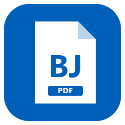
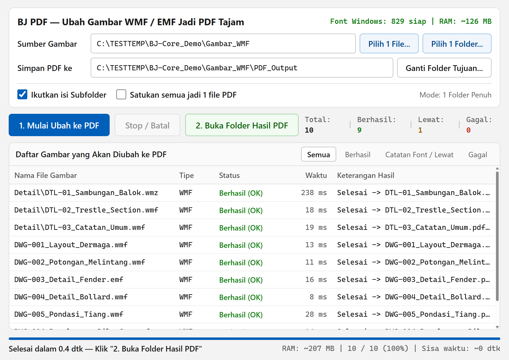

# BJ PDF — Cara Make Aplikasi (Basa Sunda Sapopoe)

**Alat paranti ngubah gambar WMF / EMF jadi PDF anu herang jeung teu pecah di Windows**  
*Bisa milih 1 file gambar hungkul, atawa langsung 1 folder pinuh. Teu ribet, tinggal klik langsung jadi PDF.*

[English (Default)](../README.md) · [Panduan Bahasa Indonesia](README_ID.md) · **Basa Sunda** · [Changelog](../CHANGELOG.md)

 

---

## 1. Cara Download & Masang di Laptop

Buka halaman [**GitHub Releases**](https://github.com/Asikraam/BJ-Core/releases/latest), terus pilih salah sahiji:

### Cara Panggampangna (Installer 1-Klik)
1. Download file **`BJ-PDF-Setup-v1.1.0-win-x64.exe`**.
2. Klik dua kali file eta, engke otomatis masang sorangan jeung langsung aya ikon **BJ PDF** dina Desktop.
3. Lamun aya tulisan biru *Windows protected your PC*, teu kudu reuwas: klik we tulisan **More info**, terus pencet tombol **Run anyway**.

### Mun Rek Pake Versi Portable (Tanpa Install)
1. Download **`BJ-PDF-v1.1.0-win-x64-Portable.zip`**.
2. Ekstrak folder ZIP-na ka mana wae (bisa dina Flashdisk atawa Data `D:`), terus buka **`BJ PDF.exe`**.

> **Catatan mun rek balik deui ka versi heubeul (`v1.0.0`):**  
> Mun ngarasa leuwih cocok make versi anu pertama, tinggal download deui di halaman [**Release v1.0.0**](https://github.com/Asikraam/BJ-Core/releases/tag/v1.0.0).

---

## 2. Cara Make (Gampang Pisan, Ngan 3 Langkah)

Aplikasi **BJ PDF** mah dijieun husus ngarah babari dipake ku saha wae, kaasup drafter senior. Teu kudu nyetel nu aneh-aneh:

### Langkah 1 — Buka BJ PDF
- Klik dua kali ikon **BJ PDF** dina Desktop.
- Di luhur katuhu aya tulisan **`Font Windows: ... siap`** warna hejo. Eta hartina sakabeh huruf di laptop geus siap ngarah tulisan dina gambar CAD teu ngageser atawa barobah pas jadi PDF.

### Langkah 2 — Pilih Gambar (Bisa 1 File Hungkul atawa 1 Folder)
Tingali tombol di belah katuhu luhur:
- **Lamun rek ngubah 1 gambar hungkul (atawa sababaraha gambar pilihan):**  
  Pencet tombol **`Pilih 1 File...`**, terus klik file `.wmf` atawa `.emf` nu rek diubah.
- **Lamun rek ngubah kabeh gambar dina 1 folder sakaligus:**  
  Pencet tombol **`Pilih 1 Folder...`**, terus pilih folderna.
- **Atawa cara paling cepet:** sered (*drag*) we langsung file gambarna atawa folderna ti Windows Explorer ka jero aplikasi **BJ PDF**.

*Catetan tambahan:*
- Kolom **Simpan PDF ke** mah otomatis kaeusian ku folder `PDF_Output`. Jadi hasil PDF-na moal pacampur jeung file WMF aslina.
- Mun hayang sakabeh gambar dihijikeun jadi 1 file PDF gabungan, tinggal centang kotak **`Satukan semua jadi 1 file PDF`**.

### Langkah 3 — Pencet "1. Mulai Ubah ke PDF" terus "2. Buka Folder Hasil PDF"
1. Pencet tombol biru **`1. Mulai Ubah ke PDF`**.
2. Tungguan sakeudeung nepi ka tulisan di handap jadi **`Selesai`**.
3. **Mun rek langsung ningali 1 file PDF-na:** tinggal **klik 2x (double-click)** we baris gambar nu geus `Berhasil (OK)` dina tabel, engke PDF-na langsung kabuka!
4. **Mun rek muka folderna:** pencet tombol hejo **`2. Buka Folder Hasil PDF`**. Aplikasi oge otomatis nginget folder terakhir, jadi isukan pas muka aplikasi deui teu kudu milih folder ti awal.

---

## 3. Sabaraha Makan RAM-na? Beneran Alus Kualitas PDF-na?

- **Irit Memori (RAM):**  
  Dina versi `v1.1.0`, **BJ PDF** ngan make RAM sakitar **`~110 MB – 160 MB` (`0.11 – 0.16 GB`)** pas hurung jeung keur ngubah gambar (bisa ditingali langsung angkanna dina baris paling handap aplikasi: `RAM: ~... MB`). Jadi enteng pisan, moal nyieun laptop ngelag sanajan bari muka AutoCAD.
- **Kualitas Gambar Tetep Tajem (2x HiDPI Vector):**  
  Gambar WMF/EMF teh lain difoto jadi gambar buram, tapi digambar ulang jadi garis vektor PDF (`dpiScale: 2`, resolusi kanvas nepi ka `16384 px`, jeung nepi ka `1.000.000` garis per gambar). Rek di-zoom nepi ka 6400% oge garis, arsiran (*hatch*), jeung hurufna tetep herang. Malah lamun aya huruf AutoCAD `.shx` (`simplex`, `romans`, `isocp`, `txt`) nu euweuh di Windows, otomatis dipilihkan huruf teknik nu bersih ngarah rapih.

---

## 4. Harti Tulisan Status dina Tabel

| Status | Warna | Hartina |
| :--- | :--- | :--- |
| **`Siap`** | Kulawu | Gambar geus asup daptar, tinggal pencet tombol *1. Mulai Ubah ke PDF*. |
| **`Proses...`** | Biru | Gambar keur diubah jadi PDF. |
| **`Berhasil (OK)`** | Hejo | Gambar geus jadi PDF vektor nu herang jeung hurufna lengkap. |
| **`OK (Font Disesuaikan)`** | Oranye | PDF geus jadi jeung rapih, ngan di jero gambarna aya jenis huruf nu can dipasang di laptop (geus otomatis disaluyukeun ku aplikasi). |
| **`Dilewati`** | Oranye | File diliwat sabab file-na ruksak atawa lain gambar WMF/EMF. |
| **`Gagal`** | Beureum | File gagal diubah (pedaranana aya dina kolom *Keterangan Hasil*). |

---

Lisensi [Apache-2.0](../LICENSE) © 2026 Aswal Ikraam Aritonang.
